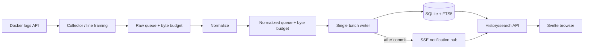

# LogPocket — Practical Implementation Guide

> Companion to [architecture.md](architecture.md) and [DEVELOPMENT_PLAN.md](DEVELOPMENT_PLAN.md)
> Status: development guidance, **not implemented code**
> Scope: single-host, local-first Docker log explorer, v0.1.0

This guide turns the architecture into a sequence of small implementation changes. The goal is to build a **working vertical slice early**, keep public GitHub commits meaningful, and learn Go, SQLite, Docker internals, and Svelte by solving actual engineering problems.

## A. Product contract and scope guardrails

At v0.1, a user should be able to install **one binary** or deploy **one container**, enable local Docker collection, watch a container's live logs, search history, filter by level/source/time, and restart LogPocket without losing committed historical records. Retention must be configurable. Failures must be visible.

Do **not** start by implementing: remote agents, authentication, complex query DSL, arbitrary SQL execution, alerting, AI analysis, Redis/Kafka, distributed persistence, or native Docker management actions.

The app is **not** a secure multi-user system in v0.1. It is local-first; a public web binding is not a supported default deployment.

## B. Decisions before any production code

| Decision | MVP choice | Validate or revisit |
|---|---|---|
| Backend | Go 1.27.x | Record exact patch version in `go.mod` / CI |
| HTTP | `net/http`, `ServeMux` | Keep handlers thin; no framework to start |
| Frontend | Svelte 5 + TypeScript + Vite | Pin versions and commit lockfile |
| Persistence | SQLite in WAL mode | Verify driver-specific FTS5, pragmas and build behavior |
| SQLite driver | `modernc.org/sqlite` provisional | Compare alternative if compatibility/perf spike fails |
| Full-text | SQLite FTS5 external-content index | Token/phrase, not arbitrary substring search |
| Live feed | SSE + durable database catch-up | Publish only after commit; prove no fetch-to-stream race |
| Docker | Docker Engine API | TTY vs non-TTY frames; log-driver limitations |
| Packaging | Go `embed` Svelte dist | Frontend **must** build before Go binary |
| Distribution | GitHub tagged binaries, Docker multiarch | Test supported OS/arch matrix |

## C. Repository setup: commit the minimum

Recommended first tracked files:

```text
logpocket/
  .github/workflows/ci.yml
  .gitignore
  .editorconfig
  README.md
  LICENSE
  SECURITY.md
  CONTRIBUTING.md
  architecture.md
  DEVELOPMENT_PLAN.md
  IMPLEMENTATION_GUIDE.md
  go.mod
  cmd/logpocket/main.go
  internal/app/app.go
  internal/config/config.go
  web/package.json
  web/package-lock.json
  web/index.html
  web/src/App.svelte
  web/vite.config.ts
```

No empty directories. Add packages when implementing their first task. Decide the module path after selecting the actual GitHub repo owner, e.g. `github.com/<owner>/logpocket`; **do not** hardcode an unowned namespace into source files.

### Toolchain validation

```bash
go version
node --version
npm --version
docker version
sqlite3 --version  # optional local debugging utility
```

Install packages from trusted upstream sources. Avoid configuring Docker daemon to allow unauthenticated TCP access or changing Docker socket permissions globally.

### Initial Go app requirements

`logpocket serve` should parse config, initialize the database, mount HTTP routes, print the listening address, and handle SIGINT/SIGTERM. `GET /healthz` returns 200 if the process is serving, `GET /readyz` reports DB/schema readiness. Docker collection is **off** unless explicitly enabled.

### Frontend embed rule

Use `web/vite.config.ts` to build the UI into `internal/web/dist/`, or copy it there deterministically. `//go:embed dist` must appear inside a Go source file in `internal/web/`; Go embedding cannot reach through `../../` outside its package. A release build executes `npm ci && npm run build` before `go build`.

## D. Concrete interfaces (illustrative Go contracts)

```go
// internal/domain/log.go
package domain

import "time"

type RawRecord struct {
    SourceID string
    Stream string
    SourceTimestamp string
    Payload []byte
    ArrivalTime time.Time
}

type LogEvent struct {
    ID int64 // assigned by SQLite, not by collectors
    SourceID string
    OccurredAt time.Time
    IngestedAt time.Time
    Stream string
    Level string
    Message string
    Raw string
    Attributes map[string]any
    ParseStatus string
    Truncated bool
}
```

Keep interfaces at the packages that **consume** them instead of building a generic framework:

```go
// Conceptual contracts, not drop-in compiling code.
type IngestSink interface {
    Submit(context.Context, domain.RawRecord) error
}

type LogReader interface {
    ListLogs(context.Context, LogFilter) (LogPage, error)
    GetLog(context.Context, int64) (domain.LogEvent, error)
}
```

Avoid global mutable state. Dependency composition takes place in `internal/app` and is tested using small fakes.

## E. Pipeline implementation, step by step



### E1. Docker collector

1. Ping/connect to Docker Engine; report daemon unavailable without exiting the HTTP server.
2. List containers; persist an internal source ID for each Docker container ID in the local daemon scope.
3. For each supported source, start **one bounded follower**; don't spawn a goroutine for each log line.
4. Request timestamps and stream output; decode the Docker multiplexed stdout/stderr framing for non-TTY containers. Treat TTY output as combined stream.
5. Reconstruct physical lines across arbitrary stream frame boundaries; enforce a 256 KiB **per-line cap** during reconstruction.
6. Send `RawRecord` through bounded ingest path.
7. Subscribe to Docker events for start/stop/recreate and recover from daemon disconnects with capped backoff.
8. On first subscription read a bounded recent history (e.g. 500 lines), **not** every historical line.
9. On restart resume from last *committed* timestamp with a short overlap; document potential duplicates and gaps because Docker does not supply a globally durable per-log-line offset.
10. Never mutate containers or Docker settings; this is a read-only **behavioral contract**, not a claim that the socket mount grants read-only access.

### E2. Normalization

Input may be plain text, JSON, invalid JSON, malformed UTF-8, unusually large payloads, multiline stack traces, and unknown timestamp formats. Convert to canonical fields `occurred_at`, `ingested_at`, `source_id`, `stream`, `level`, `message`, `attributes`, `raw`, `parse_status`, `truncated`.

Recognize common JSON severity keys/aliases. `stderr` alone must not turn a log into `ERROR`; an unknown severity stays `UNKNOWN`. Keep one physical line per row in v0.1; multiline joining comes later.

### E3. Memory and backpressure (**important**)

A fixed record count alone is **not** a sufficient memory bound: 10,000 records × 256 KiB could consume approximately 2.44 GiB for a **single** saturated queue. Cap **both record count and aggregate queued payload bytes**. Initial conservative targets to benchmark:

- Raw queue: up to 1,000 records **and** 16 MiB held bytes.
- Normalized queue: up to 1,000 records **and** 16 MiB estimated resident payload bytes.
- Maximum line: 256 KiB, checked **before** enqueue; configurable with a hard ceiling.
- SQLite batch: up to 250 rows or 100 ms elapsed.
- Limit active Docker followers (for example 64).

Implement a byte-budget semaphore, bounded queue abstraction, or equivalent mechanism; release byte reservations only after processing. Backpressure blocks follower reads and may result in missing Docker history if Docker rotates logs—surface this limitation, don't assert lossless collection.

### E4. Commit semantics

A **single SQLite writer coordinator** owns batch inserts. Within **one SQL transaction** it:

1. Stores new source metadata (if needed).
2. Inserts normalized log rows.
3. Updates source checkpoints **only up to inserted events**.
4. Lets FTS5 triggers index inserted messages.
5. Commits.
6. Publishes inserted event IDs to SSE listeners.

If the transaction fails, publish nothing and **do not advance checkpoint**. On disk full or persistent database errors, stop consuming unbounded data, mark collector/storage degraded, and allow operators to recover.

## F. SQLite strategy

Use `logs`, `sources`, `source_checkpoints`, `schema_migrations` and `logs_fts` as specified in `architecture.md`. `logs.id INTEGER PRIMARY KEY AUTOINCREMENT` is a monotonic committed ID used by SSE resume; `occurred_at_us` and `ingested_at_us` use UTC microseconds. Normal UI queries sort by `(occurred_at_us DESC, id DESC)`; live stream catches up by `id ASC`.

- Turn on WAL and verify successful activation.
- Ensure foreign keys and busy timeout apply per database connection.
- One dedicated writer connection; a small bounded read connection pool.
- Use SQL prepared/bound arguments, never concatenate user content.
- FTS5 is token/phrase search initially, **not** full substring/regex matching.
- Test insert, rollback, delete, and search index consistency.
- Retention deletes in bounded batches by ingestion timestamp. Actual DB file size is a **soft** budget because SQLite/WAL reuse/reclaim is not the same as immediate OS file shrink.
- Keep WAL on local filesystem, not an arbitrary network filesystem.

### Storage acceptance test

Insert 100 sample records → ensure text/source/time filters work → restart DB → query same committed records → delete expired rows → verify both ordinary queries and FTS5 return no deleted rows.

## G. HTTP and SSE contracts

| Route | Contract |
|---|---|
| `GET /healthz` | Process alive |
| `GET /readyz` | DB/schema ready |
| `GET /api/v1/status` | Collection/store health and warnings |
| `GET /api/v1/sources` | Known containers and state |
| `GET /api/v1/logs` | Search/page/filter historical rows |
| `GET /api/v1/logs/{id}` | Selected raw/parsed row |
| `GET /api/v1/logs/stream` | SSE stream of committed logs and resync notices |
| `GET /api/v1/stats` | Basic bounded counts |

Example history request:

```http
GET /api/v1/logs?sources=src_A&levels=ERROR,WARN&q=timeout&limit=100
```

Response uses `items`, `next_cursor`, `has_more`, and `warnings`. Page size is capped at 500; cursor uses last `(occurred_at_us,id)` and is tied to normalized query filters. Preserve a stable JSON error envelope with machine-readable error code.

### Reliable SSE catch-up

A client might query history while new rows arrive. The implementation must prevent missing committed rows at that handoff:

1. Client remembers last received `id` (or first historical fetch initializes a watermark).
2. Server registers subscriber and captures committed high-water ID under a tested coordination boundary.
3. Server reads DB rows with `id > last_id AND id <= high_water` in batches.
4. After catch-up, server switches to buffered notifications, deduplicating IDs already transmitted.
5. If client falls too far behind, server sends a resync signal or closes stream; client re-fetches history and resumes from durable ID.

Send keepalives (e.g. every 15 s), honor `Last-Event-ID`, remove disconnected subscribers, and test with concurrent inserts and network disconnects. Notifications must **never** block database writer indefinitely.

## H. Svelte interface

Build a useful UI, not a placeholder. The first page should show:

```text
┌──────────────────────────────────────────────────────────────────────────┐
│ LogPocket       [ Search messages.................... ]  ● Connected    │
├────────────────┬─────────────────────────────────────────────────────────┤
│ SOURCES        │ [Last 15m ▾] [ERROR] [WARN] [INFO] [Live ●]          │
│                ├──────────┬───────┬────────────────┬──────────────────┤
│ ☑ payments     │ Time     │ Level │ Service        │ Message          │
│ ☑ orders       │ 19:01:03 │ ERROR │ payments       │ gateway timeout  │
│ ☐ nginx        │ 19:01:04 │ INFO  │ orders         │ order accepted   │
│                │ ...      │ ...   │ ...            │ ...              │
├────────────────┴──────────┴───────┴────────────────┴──────────────────┤
│ Source degraded? Show explicit warning; no silent empty results.        │
└──────────────────────────────────────────────────────────────────────────┘
```

Key flows:

- Initial `GET /sources` + `GET /logs` render recent persisted rows.
- SSE appends fresh committed rows without resetting current scroll position.
- Pause freezes view only; ingestion/storage continues.
- Search, source, level and time filters persist in URL for shareable local links.
- Detail drawer shows safely escaped raw content, parsed attributes, source metadata.
- Render visible/virtualized rows, not 100,000 DOM nodes.
- Show loading, empty, disconnected, unsupported log driver and storage full states.

Test keyboard navigation, empty/error states, mobile viewport, and reconnect behavior. Avoid injecting untrusted log text as HTML.

## I. Safe deployment behavior

### Native

- Bind to `127.0.0.1:8080` by default.
- Docker collection starts **only** when explicitly enabled.
- Store DB under configured local data directory with restrictive permissions.

### Dockerized

- The app must listen on `0.0.0.0:8080` **inside** the container for Docker port forwarding to work.
- Publish to `127.0.0.1:8080:8080` on the **host**, not `8080:8080` exposed to all host interfaces by default.
- Mount persistent `/data`.
- Docker socket remains privileged even with a `:ro` bind mount. Document trusted operator tradeoffs, and evaluate a restricted socket proxy; never suggest `chmod 666 /var/run/docker.sock`.
- Native auth / public internet hosting remain outside v0.1.

## J. Build as 12 small PRs rather than one big drop

| PR | What changes | Definition of done |
|---|---|---|
| 01 | Repo docs, license, contribution/security policies | README identifies MVP and limitations |
| 02 | Go CLI, signal handling, `/healthz`, `/readyz` | Local process boots/stops cleanly |
| 03 | Svelte boot, embed, dev API proxy | App shell served by standalone binary |
| 04 | SQLite driver+FTS5/WAL integration spike | Cross-platform migration/integration test passes |
| 05 | Domain models, normalization fixtures | Known JSON/plain text/invalid rows normalized |
| 06 | SQLite migrations and atomic writer | Restart + rollback + FTS tests pass |
| 07 | Docker engine probe, logs and TTY demux | Test container logs decoded correctly |
| 08 | Lifecycle collection and best-effort replay | Stop/recreate/outage cases tested |
| 09 | `/sources`, `/logs`, cursors and bounded search | HTTP contract tests pass |
| 10 | SSE hub and DB-to-live handoff | No silent missing IDs under reconnect test |
| 11 | UI explorer/search/source/filter/details | Docker demo diagnosable through browser |
| 12 | Retention, packaging, CI smoke, docs, v0.1 RC | Fresh installation + recovery smoke passes |

These are grouped PR themes, not necessarily twelve equal-sized commits. Split any PR once it becomes hard to review. Use GitHub issues LP-001 through LP-053 in `DEVELOPMENT_PLAN.md` for finer tracking.

## K. Week 1 / first development session

Start with repo scaffolding, but have something real to demo immediately.

**Session 1 — CLI and local HTTP server**
- Create repo and Go module.
- Parse subcommand `serve`, add OS signal handling.
- Add config with loopback bind and data path.
- Expose `/healthz` and `/readyz` with stub DB-readiness status.
- Add small HTTP tests and GitHub Actions.
- Commit: `feat: add Go server with health and shutdown handling`.

**Session 2 — Svelte build embedded in Go**
- Create Svelte + TypeScript frontend using Vite.
- Add home screen with static header and source sidebar placeholder.
- Embed static build with Go `embed`; preserve correct static fallback rules.
- Configure dev API proxy and add a simple browser smoke test.
- Commit: `feat: serve embedded Svelte app from Go binary`.

**Session 3 — SQLite proof**
- Set up driver and SQLite migrations.
- Verify `PRAGMA journal_mode=WAL`, FTS5 table and triggers.
- Insert/query/delete records; assert index matches correctly.
- Verify no external DB is needed and binary builds on macOS arm64/Linux.
- Commit: `feat: validate SQLite WAL and FTS5 persistence`.

**Session 4 — Docker stream proof**
- Generate a demo Docker container that writes interleaved stdout/stderr.
- Retrieve streaming logs through Engine API, decode frames, split physical lines.
- Measure reconnect behavior and timestamp accuracy.
- Keep spike isolated until normalization and storage are ready.
- Commit: `spike: validate Docker log streaming and frame decoding`.

**Exit condition for week one:** a real binary can serve a simple UI; driver/FTS5 and Docker streaming risks are validated separately. Next slice connects Docker → normalizer → SQLite → browser.

## L. Test matrix and failure drills

| Test | Required proof |
|---|---|
| Corrupt JSON | Preserves raw text, no crash |
| Invalid UTF-8 | Replaces invalid sequences, flags parse status |
| Oversized line | Truncates at cap, bounded memory |
| Stdout/stderr | Correct Docker frame decoding in non-TTY mode |
| TTY mode | Combined stream, no false stderr classification |
| Docker unavailable | UI remains up, collector marked degraded |
| Container recreate | New source identity, old logs remain |
| Reconnect replay | No unwarranted exactly-once claim, gaps/dupes observable |
| SQLite rollback | No checkpoint advance or SSE event |
| Retention deletion | No phantom FTS results |
| Slow SSE client | Ingest does not block; client resyncs |
| Browser reconnect | No silent loss of retained committed rows |
| Disk full | Pauses ingest, clear status, no unbounded RAM accumulation |
| Huge history | Keyset pagination and virtualized rendering |
| Malicious log payload | Displayed as text, never executes HTML/JS |
| Docker socket config | Only documented, intentional privileged access |

## M. Release definition and next versions

**v0.1.0 release gate:** local Docker logs viewable live and historically, search/filter works, restart persistence, bounded storage/memory, visible failure states, successful fresh install, and tests/release documentation included. Benchmark 500 lines/sec and 100k-row search on documented hardware; **publish measured results, not marketing claims**.

- **v0.2:** file tailer, HTTP ingestion, export, redaction basics, backup doctor.
- **v0.3:** alerting, exception grouping, journald/syslog, more expressive search.
- **v0.4:** optional remote agent, secure authentication/mTLS, local durable spool.
- **v0.5+:** consider Rust parser experiments, Parquet archive, OpenTelemetry, optional local LLM insights **only** if warranted by measured needs.

**Next execution target:** LP-001 → LP-003 → LP-004 → LP-005 → LP-006. Treat the very first end-to-end Docker → persisted log → browser line as the first demo-worthy milestone. No application has been implemented by the planning documents.
