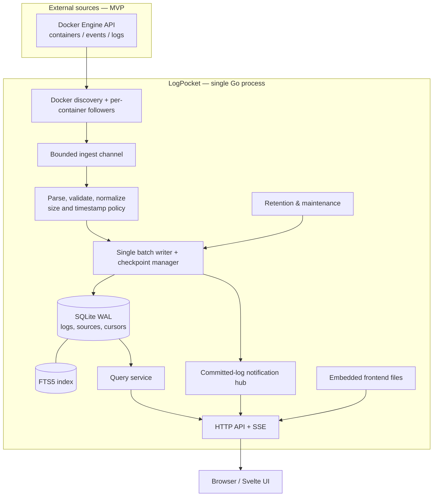
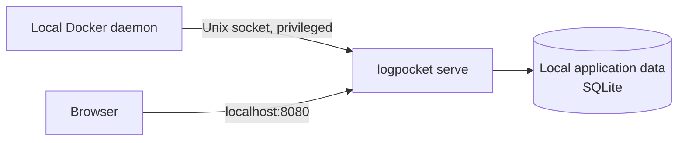
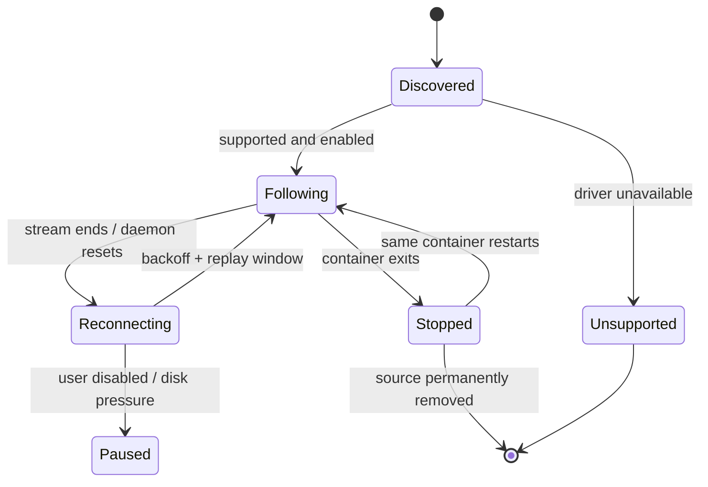

# LogPocket — Architecture

> **Status:** Proposed architecture / implementation blueprint
> **Date:** 2026-10-08
> **Target:** v0.1.0 public MVP; later features are labeled explicitly
> **License proposed:** Apache-2.0
> **Related documents:** [`DEVELOPMENT_PLAN.md`](DEVELOPMENT_PLAN.md), [`IMPLEMENTATION_GUIDE.md`](IMPLEMENTATION_GUIDE.md)

## 1. Executive summary

LogPocket is a small, self-hosted, local-first log explorer for developers and home-lab operators who want **historical logs + live tail + useful search** without installing an observability stack. One binary or Docker image hosts the collector, processing pipeline, embedded SQLite database, search endpoints, Server-Sent Events (SSE), and static browser UI. The initial scope is **single-host Docker log collection**. The architecture leaves well-defined seams for file, syslog, HTTP, journald, and remote agents, but those must **not** block v0.1.

**Product promise:** "Start one app, discover your Docker services, see live and historical logs, search them, and understand failures."
**Not a product promise:** distributed APM, tracing, production SOC logging, guaranteed lossless audit retention, or large-scale observability.

### 1.1 Users and primary workflows

| User | Problem | v0.1 user journey |
|---|---|---|
| Local developer | Log lines scattered across several containers | Start LogPocket, select containers, live-tail, filter ERROR |
| Home-lab operator | A container restarted overnight and logs are hard to find | Select yesterday's time range and search retained history |
| Open-source maintainer | Wants an easy way to reproduce and diagnose | Run demo environment, capture screenshots/export a small time range (export post-v0.1) |

### 1.2 Goals

1. One locally runnable executable or one container, **no external database**.
2. A useful UI with live stream, time-range filtering, severity/source filtering, and full-text search.
3. Logs survive application restarts and have bounded retention.
4. Simple installation on Linux and macOS (Docker integration tested on both; Windows native is a later target).
5. Transparent handling of drops, reconnects, unsupported Docker logging drivers, disk-full events, and source gaps.
6. Privacy by default: no telemetry sent outside the host, no AI or third-party API calls, no default cloud dependency.
7. Modular code that contributors can understand without running a Kubernetes cluster.

### 1.3 Non-goals for v0.1

- Multi-host agents, syslog, journald, files or generic HTTP ingestion.
- User management, public internet exposure or a hosted SaaS service.
- OpenTelemetry ingestion, distributed tracing, metrics and APM.
- Arbitrary SQL, a full query-language parser, saved searches and alert delivery.
- Exactly-once ingest guarantees, forensic integrity, long-term compliance storage.
- Full-featured log redaction engine or untrusted multi-tenant workloads.
- Arbitrary millions-of-events-per-second throughput.

**Rules:** Favor observable correctness over misleading guarantees; make tradeoffs explicit in docs, status and UI.

---

## 2. Technology and architectural decisions

| Area | Choice for v0.1 | Reason | Trade-off / revisit when |
|---|---|---|---|
| Backend | Go **1.27.x** | Learn Go; stdlib HTTP, goroutines, contexts, binary distribution | Add another language only if a measured bottleneck justifies it |
| Routing | `net/http` `ServeMux` | Modern routing, minimal transitive dependencies | Consider `chi` only if routing/middleware becomes burdensome |
| Frontend | **Svelte 5**, TypeScript, Vite | Small SPA, reactive streams, accessible UI; adds a new skill | React is fine, but no framework rewrite without strong reason |
| Styling | CSS variables + lightweight components | Small artifact and clear visual conventions | UI component library only after design needs are clear |
| DB | SQLite | Local embedded persistence | At sustained high ingest, assess partitioned or alternate storage |
| Go SQLite binding | **`modernc.org/sqlite`**, provisionally | No C toolchain for builds, `database/sql` integration | Verify FTS5, JSON functions, WAL, memory and cross-platform behavior in M0 spike; benchmark alternative `github.com/ncruces/go-sqlite3` if necessary |
| Search | **FTS5 on log message** plus ordinary B-tree indexes | Built into SQLite, familiar SQL | Trigram/field search/custom DSL after real user feedback |
| Live update | **SSE** | Server-to-browser unidirectional messages, simpler than WS | WebSocket if bidirectional use case later emerges |
| Collector | Docker Engine API | Native discovery + stdout/stderr streaming | Support only compatible log drivers; avoid pretending universal coverage |
| Deployment | Single Go binary with embedded UI and minimal Docker image | Easy OSS trial and upgrades | Separate agent/service only for remote ingestion |
| Configuration | YAML file + environment variables + CLI flags | Human-readable, scriptable | Avoid massive config frameworks |
| Releases | GitHub Actions, tagged binaries/images, checksums | Reproducible community-facing artifacts | Signing and SBOM as early release hardening |
| License | Apache-2.0 | Permissive, explicit patent grant | Decide before accepting contributions |

**Important**: The SQLite driver decision is provisional until the feature spike proves that bundled FTS5 and WAL work in the selected binary on Linux and macOS. Record the actual versions in `go.mod`, `package-lock.json`, and release notes rather than relying on this document as an eternally current version list.

### 2.1 Architecture style: modular monolith

All v0.1 components run in **one process**. Packages represent capabilities, **not** separately deployed microservices. Interfaces belong at dependency boundaries (collector ↔ pipeline, pipeline ↔ storage, API ↔ query service), not between every two functions.

Benefits: simple debugging, transactions, local install, CI, zero service discovery. Later, we can ship a small *optional* agent without splitting the core by default.

### 2.2 Key architectural invariants

- Every log row has an immutable, monotonic **database ID** used for ingestion order and live reconnect.
- **Publish after commit**: live subscribers never receive an uncommitted record.
- The database is the source of truth; SSE is an ephemeral notification transport.
- All externally accepted data is bounded: request sizes, line sizes, number of JSON fields, buffers, query limits.
- User-entered search text is parsed/escaped safely; never concatenate untrusted SQL or expose raw SQLite SQL.
- **One SQLite write coordinator** owns ingestion batches, checkpoints, source metadata updates, and retention writes.
- API/UI are loopback-only by default in supported local configurations; remote exposure needs a deliberate security story.
- A clean restart resumes collection best-effort from persisted source checkpoints; no false exactly-once claims.

---

## 3. Component architecture



| Package | Responsibility | Doesn't own |
|---|---|---|
| `internal/app` | Startup/shutdown, dependency wiring, configuration and lifecycle | Parsing/SQL business logic |
| `internal/collectors/docker` | Docker discovery, compatibility, log followers and reconnect | SQLite queries, UI, normalization policy |
| `internal/ingest` | Typed event envelope, size validation, bounded queue and pipeline | Docker transport-specific details |
| `internal/normalize` | Timestamp/severity extraction, JSON shape mapping, invalid-data handling | Database decisions |
| `internal/storage/sqlite` | Schema migrations, atomic insert + cursor updates, FTS maintenance, maintenance | HTTP responses |
| `internal/search` | Validated user filters, query planner and keyset pagination | Raw SQL exposed to browser |
| `internal/live` | Subscriber registry, bounded notifications, catch-up protocol | Persistence |
| `internal/api` | Routes, DTOs, input validation, status codes, SSE | SQL and Docker specifics |
| `internal/config` | Defaults, environment, YAML, validation | Runtime mutations |
| `internal/web` | Embedded SPA assets / cache headers | JavaScript application logic |
| `web` | Svelte SPA, source navigation, timeline, search, details, preferences | SQL and Docker socket |

**Do not** create a plugin system, Kafka event bus, generic repository/DAO abstraction, or ORM for v0.1. Prefer explicit SQL with small, carefully tested interfaces.

---

## 4. Deployment and runtime topology

### 4.1 Native single-host setup



- Native server listens on `127.0.0.1:8080` by default.
- Data defaults to a local application-data directory; explicit `--data-dir` overrides it.
- Docker integration is **opt-in**, not silently enabled. Startup reports `docker=disabled`, `docker=connected`, or `docker=error`.

### 4.2 Docker container deployment

```text
Browser --> 127.0.0.1:8080:8080 --> LogPocket container --> /data (persistent volume)
                                                    |
                                                    +--> [optional, privileged]
                                                         Docker API socket/proxy
```

- In the container, listen on `0.0.0.0:8080`; publish only to the host's **127.0.0.1** by default.
- An optional Docker socket mount is high-privilege **even with `:ro`**. For a hardened installation, use a carefully configured Docker socket authorization proxy exposing only required read/list/events/logs endpoints, with explicit risk warnings; such a proxy still must be trusted and tested.
- Never recommend `chmod 666 /var/run/docker.sock`, `--privileged`, or unauthenticated TCP Docker daemon exposure.
- Non-root image is preferred but socket permission handling is platform-specific. Document secure group/proxy approaches rather than making the app silently switch to root.
- On macOS Docker Desktop, socket availability and mount paths vary: include tested commands for supported environments, not one universal command.

### 4.3 Minimum infrastructure

- One host process (Go) and a local, writable directory.
- SQLite on a **local filesystem**. WAL is not suitable for a shared/network filesystem where readers span machines.
- No mandatory Redis, Postgres, reverse proxy, cloud credentials or collectors.

---

## 5. Domain model and ingestion contract

### 5.1 Source

`Source` represents an identified producer of logs. A Docker container recreated with a new container ID becomes a **new source**; labels retain a friendly grouping.

```json
{
  "id": "src_docker_<stable_internal_id>",
  "kind": "docker",
  "external_id": "<docker-daemon-scope>/<container-id>",
  "display_name": "payment-service",
  "host": "local",
  "labels": {"com.docker.compose.project": "demo"},
  "state": "connected"
}
```

`external_id` includes a daemon-scope identifier so that two independent Docker hosts cannot collide when remote sources arrive later. A source's display name is **not** its identity.

### 5.2 Internal input record

```go
type RawRecord struct {
    SourceID        string
    Stream          string   // stdout | stderr | combined | unknown
    TimestampText   string   // original Docker timestamp if supplied
    Payload         []byte
    ArrivalTime     time.Time
    Metadata        map[string]string
}
```

Collector-specific metadata remains on the envelope until normalization. Externally supplied values are never trusted without size and validity checks.

### 5.3 Normalized LogEvent

```json
{
  "id": 90214,
  "source_id": "src_docker_...",
  "occurred_at": "2026-10-08T12:35:41.123456Z",
  "ingested_at": "2026-10-08T12:35:41.158912Z",
  "stream": "stderr",
  "level": "ERROR",
  "message": "Payment provider timed out",
  "attributes": {"trace_id": "abc-123", "order_id": "o-901"},
  "raw": "{...original sanitized line...}",
  "parse_status": "json"
}
```

**Time semantics**:
- `occurred_at`: source event time when valid; else ingress time.
- `ingested_at`: when LogPocket accepted the event. Used for retention and diagnostics.
- Persist times as signed 64-bit **microseconds since Unix epoch UTC** for SQL indexing; serialize RFC3339 to clients.
- If timestamp is unparseable or far in future, preserve the original timestamp in metadata and mark `parse_status` / `timestamp_fallback`; do not silently alter it without a status flag.
- Never rely on source clocks to define ingestion order; database ID provides durable committed ordering.

**Level semantics**:
- Recognize `TRACE`, `DEBUG`, `INFO`, `WARN`, `ERROR`, `FATAL` plus well-known aliases.
- For JSON, inspect configurable known keys (`level`, `severity`, etc.).
- For plain text, recognize conservative common prefixes/patterns, not an aggressive magic regex.
- When uncertain, set `UNKNOWN` and retain the original text.
- `stderr` does **not automatically equal** `ERROR`.

**Payload limits (initial defaults)**:
- Maximum single line: **256 KiB**; longer lines are truncated, visibly flagged, and counted. Docker's stream frame/chunk boundaries are not necessarily log-line boundaries.
- Maximum stored JSON attributes: **64 keys** and **64 KiB serialized**; excess fields are dropped from normalized attributes, with `truncated=true`. Raw content still follows its own size cap.
- Reject invalid UTF-8 cleanly by replacement and flagging, not panicking.
- Untrusted log content must be rendered as **text**, never raw HTML.

### 5.4 Multiline strategy

MVP is **one physical log line = one event**. Stack traces remain separate rows but nearby in time; advanced multiline joining is deferred because heuristics can merge unrelated records. UI can show neighboring lines. Later a configurable multiline rule could group exception frames without changing storage identity.

---

## 6. Docker collector — detailed behavior

### 6.1 Required Engine API interactions

- Ping/version: report reachable daemon/API compatibility.
- List containers, optionally include stopped: discover sources and labels.
- Subscribe to container lifecycle events: detect creates, starts, stops, renames, deletes.
- For each eligible running container, open a logs stream with `stdout=true`, `stderr=true`, `timestamps=true`, `follow=true`, `tail` policy and `since` resume value.
- Surface unsupported logging-driver cases as **unsupported**; don't claim logs are available when the API cannot serve them.

Supported driver behavior must be verified per Docker API version and host OS. Docker Engine's container-log endpoint is not universal across logging drivers.

### 6.2 Per-container follower state machine



- Use a **per-source goroutine**, controlled by parent `context.Context`, with an upper bound on concurrent followers.
- Docker multiplexed stdout/stderr frames require decoding for non-TTY containers; TTY-enabled containers may use a combined unframed stream. Use the Docker client's tested demultiplexing behavior rather than assuming every chunk is one line.
- Maintain a bounded line-assembly buffer; handle partial frames, partial lines, long lines and stream EOF explicitly.
- Retry transient failures using capped exponential backoff with jitter; report prolonged disconnection visibly.
- Changes in `display_name` do not change source identity.
- Scope discovery initially to locally reachable Docker daemon; do not poll arbitrary network endpoints.

### 6.3 Initial history and restart semantics

**On first discovery**: default to last **500 lines** per source (configurable), not all historical logs; show a clear "initial backfill" status. Set a per-source ceiling so a dormant container with enormous logs cannot blow up initial ingestion.

**On restart**: reload last committed Docker timestamp checkpoint and request a short overlap before it (default **2 seconds**, configurable). Docker's `since` resolution/behavior and timestamp precision vary by API/version; integration tests must verify actual behavior against pinned Docker versions. The overlap trades some duplicates for reduced missed records.

**Dedupe**: best effort within a short replay window, using source ID, source timestamp, stream and payload hash with bounded occurrence bookkeeping. **Exact once is not promised**: Docker logs do not expose a durable unique per-line ID, identical records can legitimately occur at the same source timestamp, and retention/rotation can create gaps. Do not use a unique index that blindly collapses identical real events. If a durable exact position cannot be established, prefer clearly documented possible duplicates over invisible loss.

**Checkpoint rule**: update the source checkpoint in the **same SQLite transaction** as the corresponding inserted log batch. Never acknowledge a checkpoint for data not committed.

**Source gaps**: emit a source health/gap event in diagnostics when rotation, restart or driver behavior may have lost history. UI should show "coverage may be incomplete" rather than implying fully accurate historical records.

---

## 7. Ingestion processing, concurrency and backpressure

### 7.1 Pipeline

```text
Docker streams
  -> bounded raw channel (1,000 records AND 16 MiB default)
  -> N lightweight normalizer workers (small fixed/configurable count)
  -> bounded normalized channel (1,000 records AND 16 MiB)
  -> 1 SQLite batch writer
  -> committed IDs -> SSE hub
```

The normalizer can scale moderately with CPUs, but **write commits are serialized**. Avoid a goroutine per log line. All worker shutdowns honor `context.Context`.

### 7.2 Batching policy (initial defaults, tune with benchmarks)

- Batch up to **250 records** or **100 ms** of waiting, whichever comes first.
- One transaction: insert logs + FTS triggers + advance source checkpoints.
- On transient SQLite lock/busy, limited retry with backoff. On full disk/corruption, stop writes, surface critical status, never advance checkpoints, and stop collectors when memory budgets are reached.
- Return successful insert IDs in commit order and then publish to SSE; do **not** broadcast pre-commit.

### 7.3 Backpressure strategy

- Channels have **fixed record and aggregate-byte budgets**. A record count alone is insufficient: 10,000 × 256 KiB would permit over 2 GiB in a single full queue. Suggested initial limits: **1,000 records AND 16 MiB per ingest queue**. Enforce the per-line limit before enqueue; release byte reservations after processing. Never accumulate an unbounded Go slice of logs.
- When queue full, followers block/pause reading; Docker daemon buffering and log-driver rotation mean this is **not a guarantee against loss**. Track `queue_fill_ratio`, `collector_blocked_seconds`, and `suspected_gap_count`.
- Do not silently drop on normal operation. If an explicit configurable drop policy is later introduced, it requires visible counters and UI notices.
- Slow SSE browser subscribers must never block ingestion. Each subscriber has a bounded channel (e.g., 512 IDs); when it falls behind, close its stream with a resync instruction or connection termination, forcing a DB catch-up.

### 7.4 Order and delivery guarantees

- **Within storage**: log IDs reflect **transaction insert order**, not necessarily source event time.
- **Within a source**: best-effort original line order for a continuously connected follower.
- **Across sources**: no global causal ordering guarantee.
- **On reconnect**: at-least-once intent and best-effort dedupe; gaps and duplicates possible.
- **In the live UI**: only committed rows; client can resync using stored IDs.

---

## 8. SQLite data architecture

### 8.1 Core tables — proposed migration `0001_init.sql`

```sql
PRAGMA foreign_keys = ON;

CREATE TABLE IF NOT EXISTS sources (
  id TEXT PRIMARY KEY,
  kind TEXT NOT NULL,
  external_id TEXT NOT NULL,
  display_name TEXT NOT NULL,
  host TEXT NOT NULL DEFAULT 'local',
  labels_json TEXT NOT NULL DEFAULT '{}',
  state TEXT NOT NULL DEFAULT 'discovered',
  first_seen_us INTEGER NOT NULL,
  last_seen_us INTEGER NOT NULL,
  last_error TEXT,
  UNIQUE (kind, external_id)
);

CREATE TABLE IF NOT EXISTS logs (
  id INTEGER PRIMARY KEY AUTOINCREMENT,
  source_id TEXT NOT NULL REFERENCES sources(id),
  occurred_at_us INTEGER NOT NULL,
  ingested_at_us INTEGER NOT NULL,
  stream TEXT NOT NULL,
  level TEXT NOT NULL,
  message TEXT NOT NULL,
  raw TEXT NOT NULL,
  attributes_json TEXT NOT NULL DEFAULT '{}',
  parse_status TEXT NOT NULL,
  truncated INTEGER NOT NULL DEFAULT 0
);

CREATE INDEX IF NOT EXISTS idx_logs_event_time
  ON logs(occurred_at_us DESC, id DESC);
CREATE INDEX IF NOT EXISTS idx_logs_source_event_time
  ON logs(source_id, occurred_at_us DESC, id DESC);
CREATE INDEX IF NOT EXISTS idx_logs_level_event_time
  ON logs(level, occurred_at_us DESC, id DESC);
CREATE INDEX IF NOT EXISTS idx_logs_ingest_time
  ON logs(ingested_at_us, id);

CREATE TABLE IF NOT EXISTS source_checkpoints (
  source_id TEXT PRIMARY KEY REFERENCES sources(id),
  last_source_timestamp TEXT,
  last_committed_log_id INTEGER,
  updated_at_us INTEGER NOT NULL,
  checkpoint_state_json TEXT NOT NULL DEFAULT '{}'
);

CREATE TABLE IF NOT EXISTS schema_migrations (
  version INTEGER PRIMARY KEY,
  applied_at_us INTEGER NOT NULL
);

-- External-content FTS5 index. Must be maintained in the same transaction.
CREATE VIRTUAL TABLE IF NOT EXISTS logs_fts USING fts5(
  message,
  content='logs',
  content_rowid='id',
  tokenize='unicode61'
);

CREATE TRIGGER IF NOT EXISTS logs_ai AFTER INSERT ON logs BEGIN
  INSERT INTO logs_fts(rowid, message) VALUES (new.id, new.message);
END;

CREATE TRIGGER IF NOT EXISTS logs_ad AFTER DELETE ON logs BEGIN
  INSERT INTO logs_fts(logs_fts, rowid, message)
  VALUES ('delete', old.id, old.message);
END;
```

`logs` is append-only apart from retention deletion. The SQL is an **implementation starting point**, not an already migrated/tested schema. Verify foreign-key configuration per DB connection and FTS maintenance in migrations tests. Avoid hand-editing deployed databases.

### 8.2 WAL, pragmas and connection policy

- Enable `PRAGMA journal_mode=WAL` at database initialization; check the resulting mode.
- Set `PRAGMA busy_timeout=5000` on **each physical connection** (or equivalently via connection-string configuration verified by tests).
- Enable foreign keys per connection.
- Configure a dedicated single writer connection; a small read pool for HTTP queries. Avoid long-running read transactions that starve WAL checkpoints.
- Prefer `synchronous=NORMAL` with a clearly documented power-loss durability tradeoff, or `FULL` if measured reliability requirements demand it. Crash/recovery tests must be performed under the selected setting.
- Bound query execution using contexts and request deadlines.
- Coordinate checkpointing during low-load periods and monitor WAL size.
- Do not run SQLite in WAL mode on arbitrary NFS/SMB network shares.

### 8.3 Search approach

v0.1 browser accepts **plain text**, not raw SQL and not arbitrary FTS5 DSL.

Query construction:
1. Validate source IDs and allowed levels; clamp time bounds and page sizes.
2. Escape/quote user search as an **FTS5 literal phrase** or safe token-query form; use SQL bound parameters for `MATCH`, levels, sources, timestamps.
3. Join `logs_fts.rowid = logs.id` only when a search term exists.
4. Apply time/source/level filters via indexed SQL.
5. Paginate with a **keyset cursor**, not large OFFSET scans.

```sql
-- Illustrative shape, not final optimizer-guaranteed plan
SELECT l.id, l.source_id, l.occurred_at_us, l.level,
       l.message, l.stream
FROM logs AS l
JOIN logs_fts AS f ON f.rowid = l.id
WHERE logs_fts MATCH ?
  AND l.occurred_at_us >= ?
  AND l.occurred_at_us < ?
  AND (l.occurred_at_us < ?
       OR (l.occurred_at_us = ? AND l.id < ?))
ORDER BY l.occurred_at_us DESC, l.id DESC
LIMIT ?;
```

Search design caveats:
- `unicode61` is **word/token-oriented**, not general arbitrary substring/regex search.
- v0.1 supports token/phrase matching. `/abc` vs `bc` substring, punctuation and short fragments will not necessarily match as users expect; explain it in UI.
- Consider an **optional trigram index** for true substring search after benchmarking disk amplification. Don't create both token and trigram indexes by default in v0.1.
- Severity index serves simple filters; evaluate compound/index strategies with `EXPLAIN QUERY PLAN` against actual generated workloads.

### 8.4 Retention and storage budget

Proposed defaults:

```yaml
storage:
  max_age: 14d
  max_size: 2GiB      # soft operational budget, not a hard filesystem quota
  cleanup_interval: 10m
```

- Time retention operates on **ingested_at_us** (stable even when source clocks are wrong).
- Cleanup deletes **bounded batches** of old rows (e.g. 5,000 rows per transaction) and their FTS entries via triggers.
- `max_size` is a **soft target**: SQLite file/WAL growth, index overhead and file-page reuse mean bytes may exceed budget temporarily. Show measured DB, WAL and free-page sizes separately.
- At pressure thresholds, trigger cleanup/checkpoint/maintenance; if write capacity remains exhausted, **pause ingestion** and show explicit "storage full" rather than deleting arbitrary new logs silently.
- Consider `auto_vacuum=INCREMENTAL` **before schema creation** if experiments justify it. Automatic DELETE does not immediately shrink the SQLite file on disk; routine VACUUM may block and must be deliberate, not run every cleanup cycle.
- File permissions default to owner-readable and owner-writable only; logs are sensitive.

### 8.5 Backup and migrations

- Version migrations (`0001_...`, `0002_...`) with forward-only upgrade policy until v1; test upgrade from every supported prior release.
- Protect schema changes with preflight backup and free-disk checks.
- Prefer SQLite's **online backup API** for a consistent copy; copying a live `.db` without WAL handling is unsafe.
- On startup: validate schema, check critical PRAGMAs and FTS5, record version, fail with actionable messages on incompatibility.
- Provide `logpocket doctor` by v0.2 for integrity/FTS consistency checks.

---

## 9. HTTP API and live streaming

All routes are versioned under `/api/v1`. JSON responses are UTF-8. Browser UI and API share the same origin, avoiding permissive CORS by default.

### 9.1 Proposed v0.1 endpoints

| Method | Route | Function |
|---|---|---|
| `GET` | `/healthz` | Process liveness (200 if HTTP server running) |
| `GET` | `/readyz` | DB ready and migrations valid; degraded collector reported separately |
| `GET` | `/api/v1/status` | App version, backend health, queue, collector capabilities/warnings |
| `GET` | `/api/v1/sources` | Discoverable sources; filter by state/kind |
| `GET` | `/api/v1/sources/{id}` | Source detail + collector state |
| `GET` | `/api/v1/logs` | Historical page and filters |
| `GET` | `/api/v1/logs/{id}` | Full log row / raw attributes |
| `GET` | `/api/v1/logs/stream` | SSE committed-log feed with catch-up |
| `GET` | `/api/v1/stats` | Simple time-bucket counts / error counts (bounded window) |
| `GET` | `/api/v1/capabilities` | FTS type, log drivers, feature flags, configuration constraints |

Everything else is postponed; no mutable admin/API surface in v0.1 unless essential.

### 9.2 Historical query contract

```http
GET /api/v1/logs?sources=src_1,src_2&levels=ERROR,WARN&from=2026-10-08T00:00:00Z&to=2026-10-09T00:00:00Z&q=timeout&limit=100&cursor=<opaque>
```

```json
{
  "items": [
    {
      "id": 90214,
      "source_id": "src_1",
      "occurred_at": "2026-10-08T12:35:41Z",
      "level": "ERROR",
      "message": "Payment provider timed out",
      "stream": "stderr"
    }
  ],
  "next_cursor": "opaque_base64url_token_or_null",
  "has_more": false,
  "warnings": []
}
```

- Cursor contains versioned `occurred_at_us` + `id` + optionally canonicalized filter fingerprint; signing optional for local use but tampering must fail validation cleanly.
- Query limit default **100**, max **500**. Requested time range cap default **14 days**; all-time queries require an explicit finite cap and warning.
- Responses limit total bytes; a huge raw line is fetched only in detail.
- Errors use a stable body: `{"error":{"code":"INVALID_FILTER","message":"..."}}`.
- Query cancellation on client disconnect; server timeout protects database.
- Distinguish "no results" from "source disconnected / no logs collected".

### 9.3 SSE protocol

```http
GET /api/v1/logs/stream?after_id=90214
Accept: text/event-stream
```

```text
event: log
id: 90215
data: {"id":90215,"source_id":"src_1","level":"INFO","message":"..."}

: keepalive

```

**Race-free catch-up requirement**: log messages must not disappear in the gap between history fetch and SSE subscription.

Proposed algorithm:
1. Register a bounded subscriber and establish a current high-water committed database ID under the writer/hub synchronization boundary (or an equivalent tested handoff).
2. Fetch and emit stored rows with `id > after_id` and `id <= high_water` in ID order, in pages.
3. Drain buffered notifications with `id > high_water`; dedupe IDs already sent; switch to live-only updates.
4. If catch-up exceeds a bounded window, the subscriber falls behind, or requested ID is older than retained history, emit `event: resync` (or close with an explicit documented recovery signal). UI refetches from database.
5. Support `Last-Event-ID` on reconnect; if both query and header exist, define precedence and test it.

The UI should **never rely on SSE as a durable archive**. It's a low-latency transport above SQLite. Send a heartbeat about every 15 seconds; terminate slow clients gracefully and expose stream-status indicators.

### 9.4 API security rules

- Bind loopback by default; no public listener without explicit opt-in and documented auth proxy requirements.
- Disable permissive `Access-Control-Allow-Origin: *`.
- Reject oversized URLs, query strings, headers and API bodies.
- Escape all strings in UI, avoid logging auth tokens, sanitize errors.
- Set common security headers; CSP compatible with the embedded SPA.
- v0.1 has no authentication, so it is **local/trusted-only**. Do not market it as safe to expose to an untrusted network.

---

## 10. Frontend architecture and UI design

### 10.1 Application layout

```text
┌─────────────────────────────────────────────────────────────────────────┐
│ LogPocket   [Search logs                           ]  LIVE ●  Status OK │
├─────────────────┬───────────────────────────────────────────────────────┤
│ SOURCES         │ [Last 15m ▼] [ERROR/WARN ▼] [Pause stream] [Refresh] │
│                ├───────────────────────────────────────────────────────┤
│ ☑ order        │ 12:30:02 INFO  order      Order accepted             │
│ ☑ payment      │ 12:30:03 ERROR payment    Provider timeout           │
│ ☑ redis        │ 12:30:03 WARN  redis      Retrying connection        │
│ ☐ nginx        │ 12:30:04 INFO  order      Failure recorded           │
│                │ ...                                                   │
│                ├───────────────────────────────────────────────────────┤
│                │ Details / raw JSON / attributes / copy               │
├─────────────────┴───────────────────────────────────────────────────────┤
│ 4 connected    21,412 retained    Indexed    Storage 234 MB of 2 GB  │
└─────────────────────────────────────────────────────────────────────────┘
```

### 10.2 UI pages (MVP)

1. **Explorer** (`/`): source sidebar, search bar, severity chips, time range, virtualized log table, pause auto-scroll, keyboard navigation.
2. **Log detail** (drawer): full message, raw line (escaped text), formatted JSON attributes, source metadata, event/ingest timestamps, copy actions.
3. **Sources** (`/sources`): source health, collection status, unsupported Docker driver warnings, last seen and total count.
4. **Settings/status** (`/settings`): read-only config summary in MVP, storage usage, app version, connection failures, no collection credential editing.

### 10.3 Frontend state and data flow

- `API client`: typed fetch wrappers with abortable requests.
- `Query state`: URL-serializable search, filters, time range, selected source IDs (shareable local URLs).
- `History state`: paginated rows; retain bounded number of rendered logs.
- `Stream state`: connected/reconnecting/paused/degraded; dedupe by immutable ID.
- `Source state`: polling or refetch on lifecycle status changes.
- Prefer simple Svelte stores/runes; do not add Redux-style state management.
- Virtualize long lists; keep browser DOM footprint bounded (initial visible rows 100–500).
- Always indicate whether auto-scroll is **paused**; unseen-count badge accumulates until resumed.
- Accessibility: semantic HTML, keyboard shortcuts, contrast, `aria-live` for stream status without announcing every log line.
- UI must work on 13-inch laptop and smartphone widths; source sidebar collapses on mobile.

---

## 11. Configuration contract

Proposed YAML file `logpocket.yaml`:

```yaml
server:
  bind: 127.0.0.1
  port: 8080

storage:
  data_dir: ./logpocket-data
  max_age: 14d
  max_size: 2GiB
  cleanup_interval: 10m

collectors:
  docker:
    enabled: false     # explicit opt-in
    socket: unix:///var/run/docker.sock
    initial_tail_lines: 500
    resume_overlap: 2s
    max_followers: 64

ingest:
  raw_queue_capacity: 1000
  raw_queue_max_bytes: 16777216
  normalized_queue_capacity: 1000
  normalized_queue_max_bytes: 16777216
  max_line_bytes: 262144
  batch_size: 250
  flush_interval: 100ms

search:
  default_page_size: 100
  max_page_size: 500

logging:
  level: info
```

**Precedence:** CLI flags > environment variables (`LOGPOCKET_*`) > file > defaults. Validate configuration before opening collectors; print only non-secret effective configuration. The sample is a **target contract**, not an implemented parser. v0.1 may start with a smaller public config surface; undocumented internal knobs should not be exposed as prematurely stable API.

Other CLI commands:

```bash
logpocket serve --config ./logpocket.yaml
logpocket version
logpocket config check --config ./logpocket.yaml
# v0.2: logpocket doctor
# v0.2: logpocket backup / restore
```

---

## 12. Security, privacy, and trust boundaries

### 12.1 Threat model

| Threat | Mitigation | Remaining caveat |
|---|---|---|
| Docker socket abuse | Explicit opt-in, warning, privileged trust boundary, prefer endpoint-scoped proxy | Even mounted `:ro`, socket clients may be able to issue powerful daemon requests |
| Remote user reads sensitive logs | Loopback-only defaults, no public exposure before authentication | Anyone with local host/browser access may see logs |
| Secret/PII in log events | Documentation, restrictive storage permissions, no external telemetry; configurable redaction later | **No guarantee of PII-safe storage in v0.1** |
| Malicious log text / XSS | Render log content as text, CSP, no unsafe HTML injection | Evaluate UI libraries and Markdown rendering if added |
| Search injection | Bound parameters, whitelist filters, escape FTS input, never raw SQL | FTS query syntax has special operators requiring careful escaping |
| Log ingestion DoS | Bounded queue, line, JSON and query limits; rate/size budgets | Local Docker daemon still may produce logs faster than ingestion can read |
| Disk exhaustion | Retention + soft size budget + clear pause/error status | LogPocket is not a hard disk quota enforcer |
| Backup exposure | Owner-only file permissions, clearly documented backup location | Encryption at rest out of scope v0.1 |
| Supply chain | Dependency review, pinned lockfiles, CI checks, release checksums | Additional signing/SBOM hardening in pre-v1 |

### 12.2 Operating rules

- Startup warns clearly if Docker collection enabled.
- For shared/remote installs, require an authenticated reverse proxy + TLS initially (until native authentication is designed/tested); not a v0.1 supported default deployment.
- Do not expose operational/debug endpoints that reveal host paths, environment secrets, or raw stack traces.
- All diagnostic logs produced by LogPocket must avoid recursively ingesting itself by default and redact obvious credentials from errors.
- Provide a responsible disclosure pathway (`SECURITY.md`) before first broad release.

---

## 13. Reliability, failure handling and recovery

| Failure | Expected behavior | Verify with test |
|---|---|---|
| Docker daemon unavailable on startup | UI and database start; collector status degraded; retry | Start without Docker then bring it online |
| Docker daemon restarts | Followers reconnect with backoff and overlap | Restart daemon during active logs |
| Container exits/restarts | Update source state; resume same ID when possible | Stop/start test container |
| Container recreated | New source identity; preserve old logs | Compose recreate / remove + new container |
| Unsupported log driver | Mark source unsupported; explain actionable next steps | Test non-readable driver / mock API |
| SQLite is busy | Retry within bound; never publish before commit | Locked connection scenario |
| Disk full / read-only volume | Pause ingestion; health degraded; avoid checkpoint advancement | Disk quota simulation |
| User's browser offline | Historical rows retained; SSE reconnect catch-up | Kill browser network connection |
| Browser slow | Bounded SSE queues; close/resync slow stream | Artificially throttle SSE consumer |
| App force-killed during batch | Transaction rolls back; checkpoint not advanced | Kill -9 during inserts |
| Retention deletes old rows | FTS returns no stale matches | Insert → purge → search |
| Invalid huge log line | Truncate and warn; app stays responsive | >256 KiB log entry |
| Clock skew | Record fallback/diagnostic flag; ingest order stable | Invalid/future timestamps |

**Shutdown order:** stop discovery → cancel readers → drain in-memory queues up to configurable deadline → commit remaining batch/checkpoints → close SSE streams → close DB → exit. On forced kill, transaction atomicity and replay policy handle the residual gap/overlap as well as possible.

---

## 14. Performance budgets and benchmarking

These are **acceptance targets to measure**, not advertised or guaranteed results.

| Measurement | Initial target / methodology |
|---|---|
| Steady ingestion | ≥500 average-size log lines/s for 10 minutes on a documented reference host without unreported queue drops |
| Search latency | p95 <1 s against 100,000 representative stored lines for common filtered word searches |
| Live latency | p95 <500 ms from successful DB commit to healthy local browser receiving SSE event |
| Idle memory | Record actual RSS with 5 idle Docker containers, no fixed marketing claim until measurement |
| Crash recovery | No uncommitted checkpoint advancement; restart tests document loss/duplicate behavior |
| Storage overhead | Document DB, FTS and WAL bytes per input GB from realistic test corpus |
| Browser | Responsive with 100k stored rows without rendering 100k DOM nodes |

Benchmark source must be reproducible and public: add `tools/log-generator`, workload profiles (`simple`, `json-heavy`, `burst`, `multiline`, `huge-lines`), and `benchmarks/README.md` with CPU/RAM/OS/Docker/version/corpus size and repeated runs. Profiles should include simulated failures and storage near cap.

No false comparison claims against Loki, Dozzle or OpenObserve without equal workloads and hardware.

---

## 15. Testing strategy

### Go

- Unit: parsers (JSON/plain text), severity extraction, timestamp fallback, UTF-8, truncation, cursor validation, config.
- Unit/property/fuzz: FTS escaping, malformed Docker frame parsing, invalid JSON, partial input chunks, large payloads.
- DB integration: migration, FTS triggers, retention deletes, rollback atomicity, concurrent readers/WAL, keyset pagination and source checkpoint transactions.
- Collector integration: fake Docker API server covering list/events/log stream, reconnect, stream demultiplex, unexpected EOF, duplicate overlap.
- End-to-end integration: real Docker Compose demo emits known INFO/WARN/ERROR messages; verify UI/API shows them and persists after restart.
- Race tests: `go test -race ./...`, cancellation, channel closure, subscriber backlog.
- Performance: ingest/search/retention microbenchmarks and full-system benchmark harness.

### Frontend

- Vitest: query filter serialization, cursor merging, SSE event handling, pause/resume, high volume rows.
- Playwright: navigation, source selection, live incoming log, search with empty results, details drawer, mobile viewport.
- Accessibility: keyboard traversal, labels, semantic controls, contrast checks.

### Test environments

- macOS arm64 (Apple Silicon) native binary + Docker Desktop where supported.
- Linux amd64 and arm64 in CI and container smoke tests.
- Windows native is best-effort after MVP, not a blocking support promise.
- Test real Docker availability and supported drivers, not only mocked APIs.

---

## 16. Observability of LogPocket itself

`GET /api/v1/status` must expose diagnostic signals:

```json
{
  "version": "0.1.0",
  "db": {"state": "ok", "db_bytes": 12345678, "wal_bytes": 90123},
  "ingestion": {"queue_fill_pct": 12, "committed_total": 4221,
                 "truncated_total": 2, "suspected_gap_total": 0},
  "collector": {"docker": "connected", "sources_following": 5,
                "sources_unsupported": 0},
  "stream": {"subscribers": 2}
}
```

Also expose structured internal diagnostic logs and concise lifecycle messages. Prometheus-format metrics (`/metrics`) can be introduced later; do not export extra ports in v0.1.

---

## 17. Proposed repository structure

```text
logpocket/
├── README.md
├── architecture.md
├── DEVELOPMENT_PLAN.md
├── LICENSE
├── CONTRIBUTING.md
├── CODE_OF_CONDUCT.md
├── SECURITY.md
├── .editorconfig
├── .gitignore
├── .github/
│   ├── ISSUE_TEMPLATE/
│   ├── PULL_REQUEST_TEMPLATE.md
│   └── workflows/
│       ├── ci.yml
│       ├── docker.yml
│       └── release.yml
├── cmd/
│   └── logpocket/
│       └── main.go
├── internal/
│   ├── app/
│   ├── api/
│   ├── collectors/
│   │   └── docker/
│   ├── config/
│   ├── domain/
│   ├── ingest/
│   ├── normalize/
│   ├── live/
│   ├── search/
│   ├── storage/
│   │   └── sqlite/
│   │       ├── migrations/
│   │       ├── db.go
│   │       ├── logs.go
│   │       ├── sources.go
│   │       └── retention.go
│   └── web/
│       ├── assets.go
│       └── dist/                  # generated Vite build embedded by Go
├── web/
│   ├── src/
│   │   ├── lib/
│   │   │   ├── api/
│   │   │   ├── components/
│   │   │   ├── stores/
│   │   │   └── types/
│   │   └── routes-or-pages/
│   ├── package.json
│   └── vite.config.ts
├── configs/
│   └── logpocket.example.yaml
├── deploy/
│   ├── Dockerfile
│   └── compose.example.yaml
├── test/
│   ├── integration/
│   └── fixtures/
├── tools/
│   └── log-generator/
├── benchmarks/
├── docs/
│   ├── installation.md
│   ├── configuration.md
│   ├── troubleshooting.md
│   ├── security-model.md
│   ├── limitations.md
│   └── adr/
└── go.mod
```

Vite output must be copied or configured to build into `internal/web/dist/` before `go build`: Go `//go:embed` patterns cannot reference parent directories outside the package (e.g. `../../web/dist`). Set the Vite output directory or a deterministic build/copy step, and use `//go:embed dist` inside `internal/web/assets.go`. In CI and releases: `npm ci && npm run build` **before** compiling the Go binary. During native frontend development, use the Vite dev server with an API proxy.

No fake empty boilerplate directories in the initial commit: add packages when the corresponding milestone begins. The tree above is the **target** structure, not a command to generate empty files.

### 17.1 Dependency direction

```text
cmd -> app -> [api, collectors, ingest, storage, live]
api -> domain interfaces + search
collectors -> domain input types + ingest sink
normalizer -> domain types
storage -> domain types
search -> storage read interface
live -> immutable committed IDs / read interface
web (browser) -> HTTP API only
```

There must never be `storage -> api` or `domain -> Docker SDK` imports. `domain` should stay boring and framework-independent. Keep interfaces near consumers and avoid unnecessary layers.

---

## 18. Release and operational contract

### Supported v0.1 modes

1. Native Linux/macOS executable against reachable Docker API (tested host matrices documented).
2. Local-only Docker container deployment with persistent `/data`; Docker collection explicitly enabled if access is available.
3. **Not supported:** internet-facing unauthenticated instances, network-share SQLite volumes, large shared clusters or compliance/audit retention promises.

### Release contents

- Versioned `logpocket` binary for Linux amd64, Linux arm64 and macOS arm64; macOS amd64 only if tested.
- Multiarch Docker image and digest.
- SHA256 checksums and release notes.
- Example compose/config, demo logs, troubleshooting guide and security warnings.
- Deterministic-ish builds pinned to Go/Node dependency versions with verifiable CI metadata.

### License and contributor experience

- Apache-2.0 source license; verify licenses of imported dependencies.
- `CONTRIBUTING.md`: prerequisites, 3-command local dev setup, test instructions, code style, issue/PR policy.
- `SECURITY.md`: private vulnerability disclosure channel.
- `CODE_OF_CONDUCT.md`, templates, `good first issue`, architecture decisions, documentation for new contributor modules.
- Start with maintainable issues, demos and screenshots, **not** daily meaningless commits.

---

## 19. ADRs — decisions to record and revisit

| ADR | Decision | Reason | Revisit when |
|---|---|---|---|
| ADR-001 | Go 1.27 backend | Systems/networking learning, deployment | Material scalability or library constraints |
| ADR-002 | Svelte + TypeScript frontend | Small UI / new learning | UI limitations evidenced by users |
| ADR-003 | SQLite + FTS5 | Embedded searchable persistence | Proven storage/search ceilings |
| ADR-004 | Single writer and batch commits | SQLite WAL single-writer constraints | New storage engine |
| ADR-005 | SSE with DB catch-up | One-way stream, durable truth remains DB | Bidirectional need |
| ADR-006 | Local/trusted-only v0.1 | Sensitive logs, no built-in auth yet | Before remote users are supported |
| ADR-007 | Docker-first and optional collection | Clear usable MVP | Stable primary workflow achieved |
| ADR-008 | No exactly-once guarantee | Docker logs lacks durable unique line IDs | New sources with proper replay IDs |
| ADR-009 | Plain-text FTS search | Small understandable UX and safe parsing | Structured query language is a validated requirement |

Each ADR lives in `docs/adr/NNNN-title.md` and includes status, context, alternatives, consequences, and references.

---

## 20. Later evolution — explicitly outside v0.1

### v0.2 — Useful for more developers

- File collector with inode + offset persistence and file rotation detection.
- HTTP ingest endpoint with API key and request quota (auth **required** for network ingest).
- Export JSONL/CSV within bounded query window.
- Configurable secret redaction, known-problem warnings, storage backup command.
- Log grouping and related logs by shared attributes.

### v0.3 — Simple operations

- Alert rules with rate windows, notifications and deduplication.
- Syslog RFC3164/5424 collector; journald integration on Linux.
- Simple aggregate dashboards and saved searches.
- Basic query language (lexer → AST → safe SQL planner) if users need it.

### v0.4+ — Multi-host / advanced learning

- Optional Go agent with disk spool, authenticated batch transport, retry, backpressure and TLS/mTLS.
- OpenTelemetry logs ingestion (with schema versioning and semantic mapping).
- Storage compression/partitioning; prototype Rust parser or Parquet cold storage **only after benchmarks**.
- Optional local LLM log summarizer (disabled by default; privacy-first).

**Rule for future features:** New subsystem must come with a user problem, measurable acceptance criteria, operations story, migration path and documentation. Don't bolt on AI or distributed architecture simply to increase complexity.

---

## 21. References and verification checklist

- Go releases: https://go.dev/doc/devel/release (Go 1.27 released August 2026).
- SQLite WAL: https://www.sqlite.org/wal.html (single writer; readers concurrent; local FS constraints).
- SQLite FTS5: https://www.sqlite.org/fts5.html (external content, triggers, tokenizer semantics).
- Docker Engine API: https://docs.docker.com/reference/api/engine/ (logging endpoint behavior depends on drivers/API version).
- Docker daemon access security: https://docs.docker.com/engine/security/protect-access/.
- Go SQLite driver candidate: https://modernc.org/sqlite; alternative: https://github.com/ncruces/go-sqlite3.

Before implementation check: actual Docker SDK version/Engine compatibility, FTS5 availability in the selected driver, packaged binary integration tests, socket proxy privileges, UI browser SSE behavior, WAL retention/page reuse, and final Go patch release.

---

## 22. Definition of architectural completion

Architecture is sufficiently implemented for v0.1 **only when**:

- A non-expert can start LogPocket locally, enable Docker collection knowingly, and see logs.
- Logged rows remain searchable after LogPocket and the Docker source restart (with documented restart caveats).
- SSE never displays a record that failed its storage commit.
- Search is time/source/severity filterable, paginated, cancellable, and injection-resistant.
- Retention removes old FTS entries and has explainable disk-budget semantics.
- All buffers and ingestion concurrency are bounded; errors/gaps/unsupported sources are visible.
- Tests, docs, security warnings, CI builds, screenshots, LICENSE and downloadable releases exist.

**See [`DEVELOPMENT_PLAN.md`](DEVELOPMENT_PLAN.md) for implementation order, issue checklists, and release gates.**
